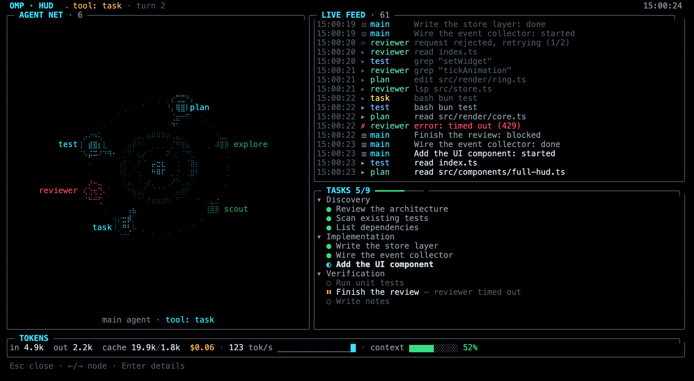
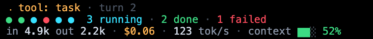
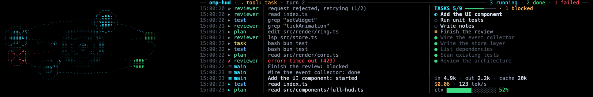

# omp-hud

English | [Türkçe](README.tr.md)

Terminal HUD for [oh-my-pi](https://github.com/can1357/oh-my-pi) (`omp`): an animated agent core, sub-agent nodes, a live feed, tasks and token gauges, inspired by sci-fi cockpit HUDs. Unofficial community extension; it installs into a stock `omp`, no fork.



*Rendered from the HTML preview (`scripts/preview.ts`); braille looks denser in a real terminal.*

## Features

- **Animated agent core** in the middle: the main agent, with its current state (idle, thinking, streaming, running a tool).
- **Sub-agent nodes** orbit the core: a running node pulses, a finished one turns green, a failed one turns red.
- **Live feed** of tool calls, sub-agent starts and finishes, retries and context compaction.
- **Tasks**: your todo list with progress.
- **Token gauges**: input / output / cache tokens, context window usage in %, tokens per second and cost.
- **Dock** above the editor (small 8 / medium 12 / large 16 rows, large by default), on from the start of a session: the HUD stays visible while you type and read answers.
- **Fullscreen mode** with `/hud full`, on the alternate screen: live panels plus a conversation panel and a prompt, so you can write to the agent and read its answers without leaving it; the normal screen is restored on exit.
- **Compact panel** (`/hud compact on`): the older 1-3 row view below the editor.
- **`/hud demo`**: a fake event stream (about 45 s loop) so you can see everything without spending a token.
- **English and Turkish** UI (`en` / `tr`, auto-detected, switchable at runtime).



## Dock



*Demo frame at 200 columns (`/hud demo`), rendered from the HTML preview; braille looks denser in a real terminal.*

The dock is a panel that sits right above the editor, so you can keep typing prompts and reading answers while the HUD stays visible. Unlike the fullscreen overlay it does not take focus. Sizes: **small 8, medium 12, large 16 rows** (large is the default); it never takes more than 45% of the terminal height (at least 4 rows; on terminals shorter than 20 rows it shrinks to 4-6 rows).

- **Wide terminals are used.** From 70 columns the orbit scene takes 38% of the width (28-72 columns): the core stays round while the orbits are ellipses that fill the whole area, and the sub-agent nodes sit on them (running nodes pulse, finished ones are green, failed ones red). From 96 columns on the right side splits into the live feed and a column with tasks and token gauges. Below 70 columns the orbit is replaced by a compact status block plus the tail of the feed.
- **It is alive when nothing runs.** The resting core is a bright breathing "eye"; a few dim placeholder sparkles drift on the orbits (they are not nodes and disappear when real nodes arrive), a short caption under the core says what the main agent is doing, and the right side shows the last events of the main agent (or a tip line with `/hud demo`, `/hud size`, `/hud help`), the first open task and the token totals (`no tokens yet` before the first request). Thinking, streaming, tool, error and done have their own core animation, also at dock size.
- **Tasks:** the active task comes first, then the pending ones; blocked tasks come last (`2 blocked` in the header), so a long list of blocked items does not hide what you can do next.

The dock takes its rows from the transcript above it; use `/hud size small` (or `OMP_HUD_SIZE=small`) on short terminals. The idle dock redraws about 4 times per second, a busy one about 8. Commands: see `/hud help`.

**Why the dock is the default.** The fullscreen HUD covers the whole screen. It has its own prompt and conversation panel, but it is not omp's editor (no multi-line input, attachments or slash commands other than `/hud ...`), and the 1-3 row compact panel is easy to lose at the bottom of the screen. The dock stays visible where you work (above the prompt), is not clipped by windows that hide the last rows, and can be hidden with `/hud` when you need the space.

Preview without omp: `bun scripts/preview.ts --dock --size large --width 200 --rows 45 --at 3,14,24,36` (add `--idle empty|tasks|used` for a resting dock instead of the demo, `--html out.html` for an HTML file).

## Full screen

`/hud full` opens the HUD on the alternate screen and takes focus. Besides the live panels it has its own **conversation panel** (your messages and the agent's answers, streamed live; thinking and tool calls are not shown, they are in the feed) and a **prompt** at the bottom.

- **Layout.** From 110 columns: the agent orbit on the left (34 columns), the conversation on the right (about two thirds of the height) with a thin feed and a one-line task summary below it. From 70 columns: a small orbit on top, then the conversation and a short feed. Narrower: conversation, a short feed and the prompt. The token strip and the prompt (rule, input row, key hint) are always at the bottom. Node details replace the orbit (or the conversation on small screens).
- **Sending.** `Enter` sends the text to omp as a user message. While the agent is busy the message waits in the queue (a `· queued` tag marks it) and runs after the current turn; `Alt+Enter` steers the running turn instead (`· steering`). A message you send appears at once and is matched with omp's own user message, so it is never shown twice. The conversation also shows messages typed in the editor and, at session start or after a session switch, the last 40 messages of the session history.
- **Commands.** Only `/hud ...` lines run inside the HUD (for example `/hud help`, `/hud lang tr`); their output appears in the conversation panel with a `hud ▸` label. Any other `/` line is refused with a hint (omp does not expand commands for text sent by extensions), and the text stays in the prompt.
- **Scrolling.** The panel follows the newest line. `PgUp` / `Ctrl+↑` stop following (the title shows `↓ new`); new text then does not move what you read. `End` / `Ctrl+End` follow again.
- **Text handling.** Control characters and ANSI sequences are stripped from messages; very long messages are clipped (12 KB each, 40 messages kept). Markdown is shown as plain text: headings and bold markers are dropped, lists keep their markers, code blocks are dim, indented and clipped instead of wrapped.

Try it without a model: `/hud demo full` (typing there never reaches omp).

## Install

Requires `omp` (oh-my-pi) with extension support. Developed and tested on **omp 18.8.9** only (see [Compatibility](#compatibility-and-honest-limits)). There is no build step and no dependencies: omp runs the TypeScript directly.

### From GitHub (main method)

```sh
omp plugin install github:suleymanozcan/omp-hud
```

`omp install github:suleymanozcan/omp-hud` is an alias, and `git+https://github.com/suleymanozcan/omp-hud.git` works as the spec too (omp's git spec grammar: `github:user/repo[#ref]`, `git+https://...`, `git@github.com:user/repo`). Restart `omp` afterwards: extensions are loaded only at startup. Update with `omp plugin upgrade omp-hud`, remove with `omp plugin uninstall omp-hud`.

> Verified with omp 18.8.9 in an isolated profile: `omp plugin install github:suleymanozcan/omp-hud` installs `omp-hud@0.1.0`; `omp plugin list` and `omp plugin doctor` report it healthy; `/hud help` and `/hud lang en` work after a restart. `omp install github:suleymanozcan/omp-hud`, `git+https://github.com/suleymanozcan/omp-hud.git` and `omp plugin upgrade omp-hud` were run the same way and succeeded (the `git@github.com:` form was not run).

### From a local clone (tested)

```sh
git clone https://github.com/suleymanozcan/omp-hud.git
omp plugin link ./omp-hud
```

`omp plugin link` symlinks the clone into omp's plugin directory (`omp install ./omp-hud` does the same). Update with `git pull` in the clone. Restart `omp` afterwards.

### Symlink into the extensions directory (tested)

```sh
mkdir -p ~/.omp/agent/extensions
ln -s "$PWD/omp-hud" ~/.omp/agent/extensions/hud
```

omp scans `~/.omp/agent/extensions/<name>/` and reads `package.json#omp.extensions`.

> A redirect file such as `~/.omp/agent/extensions/hud/index.ts` containing `export { default } from "/path/to/omp-hud/index.ts"` does **not** work: omp cannot resolve `@oh-my-pi/pi-tui` from the redirect file. Use a symlink to the whole directory.

### Try it without installing (tested)

```sh
omp -e ./omp-hud
```

### Config file (tested)

In `~/.omp/agent/config.yml` (use the full path of your clone):

```yaml
extensions:
  - /absolute/path/to/omp-hud
```

## Usage

| Command | Effect |
| --- | --- |
| `/hud` | Show or hide the dock (default view; on at session start): an 8 / 12 / 16 row panel next to the editor, no focus taken, you keep typing. |
| `/hud full` | The fullscreen HUD with a conversation panel and a prompt (the last row is kept free by `/hud pad`). |
| `/hud size small\|medium\|large` | Dock size: 8 / 12 / 16 rows (default large, env `OMP_HUD_SIZE`); no argument shows it and the rows it takes at this terminal height. |
| `/hud place above\|below` | Dock above (default) or below the editor (env `OMP_HUD_PLACE`); the dock is re-installed when open. |
| `/hud demo` | A fake event stream in the dock (opens it for the demo if needed; run it again or `/hud demo off` to stop). The real session state is not touched. |
| `/hud demo full` | The same fake stream in the fullscreen HUD. |
| `/hud compact on\|off` | The older 1-3 row panel below the editor (no argument: toggle). Turning it on closes the dock and the other way round: both would show the same data twice. |
| `/hud lang tr\|en\|auto` | Switch the UI language for this run (not persisted); no argument shows the current one. |
| `/hud status on\|off` | One-line summary (`hud ○ ready`, `hud ⠹ thinking · 2 running 1 done · in 12k out 3k · ctx 42%`) in omp's status text, on by default; no argument shows the state. |
| `/hud pad 0-3` | Blank rows kept free at the bottom of views below the editor and the fullscreen HUD (default 1, env `OMP_HUD_PAD`); no argument shows the value. It does not apply to the dock above the editor. |
| `/hud doctor` | Diagnostics: version, language, mode, dock / compact / status line state, terminal size, store, timer. No environment dump (only `OMP_HUD_LANG` and `COLORTERM`). |
| `/hud help` | Print the command summary. |

Every command answers with a short notification (for example `Compact HUD: on (1-3 lines below the editor)`, or `already on`).

Keys in fullscreen (details in [Full screen](#full-screen)):

| Key | Effect |
| --- | --- |
| text, `Backspace`, `Delete`, `←` / `→`, `Home` / `End`, `Ctrl+A` / `Ctrl+E`, `Ctrl+U` (clear), `Ctrl+W` (delete word), `Ctrl+K` (delete to end), paste | Edit the prompt. |
| `↑` / `↓` | Prompt history of this session (50 entries). |
| `Enter` | Send the prompt. With an empty prompt and a node selected: open or close its details. |
| `Alt+Enter` | Send as a steer into the running turn (default while busy: queued behind it). |
| `Tab` / `Shift+Tab` | Select the next / previous node. |
| `PgUp` / `PgDn`, `Ctrl+↑` / `Ctrl+↓` | Scroll the conversation. |
| `End` (empty prompt), `Ctrl+End` | Jump to the newest line and follow it again. |
| `Esc` | Close the node details if open; else clear a non-empty prompt; else leave the HUD. |

### Language

The UI follows `OMP_HUD_LANG=en|tr`; if unset, the first non-empty of `LC_ALL`, `LC_MESSAGES`, `LANG` decides (`tr…` gives Turkish), otherwise English.

```sh
OMP_HUD_LANG=en omp
```

## Preview without omp

You only need [Bun](https://bun.sh). Nothing here starts omp or calls a model; the demo runs on virtual time.

```sh
# watch live in your terminal (alternate screen, ~15 fps; Esc / Ctrl-C quits)
bun scripts/preview.ts --live

# print frames as 24-bit ANSI text
bun scripts/preview.ts --frames 3 --width 140 --height 40 --at 3,14,24

# write an HTML page (add --compact for the compact widget)
bun scripts/preview.ts --frames 2 --width 140 --height 40 --at 14,24 --compact --html /tmp/hud.html
```

`bun scripts/preview.ts --help` lists all options. The commands work from any directory.

## Compatibility and honest limits

- **Tested on omp 18.8.9 only** (macOS; Ghostty and cmux). Other omp versions and other terminals: unknown.
- **It relies on undocumented internals.** Sub-agent data comes from the `task:subagent:lifecycle` and `task:subagent:progress` events on `pi.events`, and fullscreen uses the overlay `fullscreen` option. Neither is a documented contract, so an omp update can break them. There are fallbacks: if the sub-agent events change, sub-agent nodes may stay empty while the core, feed, tasks and token gauges keep working; if `fullscreen` disappears, the HUD falls back to a normal overlay.
- **It does not replace omp's main view.** `setHeader` / `setFooter` have no effect in omp, so the HUD shows up only as widgets (the dock next to the editor, the compact panel below it), the status text line and the fullscreen overlay.
- **Full screen has its own prompt, not the editor.** `/hud full` shows a conversation panel and a one-line prompt, but not omp's editor: no multi-line input, no attachments or `@` autocomplete, and only `/hud ...` slash commands (other `/` commands are refused with a hint; press `Esc` and use the editor). Text you send goes to the agent as a plain user message (no template expansion). The dock does not take focus: there you keep using the normal editor.
- **Terminal:** braille and block characters are used heavily; a truecolor terminal (`COLORTERM=truecolor`) with a font that renders braille well is recommended. The terminal must be at least 50x14. The HUD is not installed in non-TUI modes.
- **Overlap with built-in features:** omp's Agent Hub (`Alt+A`) shows similar sub-agent data. If the built-in pinned "Subagents" block above the editor overlaps with the HUD, set `display.pinnedAgents: off`.

## Troubleshooting

- Nothing shows up: restart `omp` (extensions load only at startup) and run `/hud help`. If the command is unknown, the extension was not loaded.
- Look in the omp logs (`~/.omp/logs/`; a named profile logs to `~/.omp/profiles/<name>/logs/`) for `Failed to load extension`. Typical causes: a wrong or moved path, or a redirect file instead of a symlink (see above).
- Faded colors: set `COLORTERM=truecolor` in your terminal.
- Garbled fullscreen after a resize: resize once more and run `/hud full` again.
- The HUD is not visible: run `/hud doctor`. The `dock:` line shows whether it is on, its size and the rows it should take, the result of the last `setWidget` call, `mounted: yes` (omp created the widget) and what it last drew (`renders N (last WxH)`). Also check `/hud` (it answers with a notification: `HUD dock: on (large, above the editor)` or `off`), and that the terminal is at least about 20 rows tall (on shorter terminals the dock shrinks to 4-6 rows).
- Bottom rows are cut off by the terminal window (some windows hide the last row or two): the dock sits above the editor, so it is not affected. Views below the editor are: `/hud place below`, `/hud compact on` and the fullscreen HUD. For those, `/hud pad 2` (or `OMP_HUD_PAD=2`; 0-3, default 1) keeps that many blank rows under the panel and makes the fullscreen HUD that many rows shorter, so its last hint line stays visible. Padding is not applied to the dock when it is above the editor.
- Still nothing at the bottom: the HUD also writes a one-line summary into omp's status text (`hud ○ ready`, key `hud`; verified on omp 18.8.9 as one line under the editor). It does not depend on the widgets. Turn it on with `/hud status on`. If it does not appear, check that omp's `statusLine.showHookStatus` is not `false`.

## Development

```sh
bunx -p typescript tsc --noEmit -p .   # typecheck (plain `bunx tsc` resolves the wrong package)
bun scripts/smoke-collector.ts         # collector / store smoke checks
bun scripts/preview.ts --live          # look at it
```

There is no test suite yet.

```
index.ts                 extension entry: commands, timer
src/types.ts             data contract (HudState, HudStore, HudTheme)
src/store.ts             store
src/collector.ts         writes omp events into the store
src/demo.ts              fake event stream for /hud demo
src/i18n.ts              en / tr strings
src/status-text.ts       one-line plain-text summary for the status bar
src/pad.ts               bottom padding (`/hud pad`, `OMP_HUD_PAD`)
src/layout-settings.ts   dock size and place (`/hud size`, `/hud place`, `OMP_HUD_SIZE`, `OMP_HUD_PLACE`)
src/dock-i18n.ts         dock-only en / tr strings
src/render/              braille canvas, core, orbit, feed, tasks, tokens, layout
src/components/          DockHud (widget next to the editor), FullHud (overlay), CompactHud (1-3 rows), PaddedComponent
scripts/preview.ts       preview without omp (frames / HTML / live)
scripts/ansi-to-html.ts  ANSI to HTML converter for the preview
scripts/shim-pi-tui.ts   stand-in for pi-tui under plain bun (preview and smoke only)
```

## License

[MIT](LICENSE)
