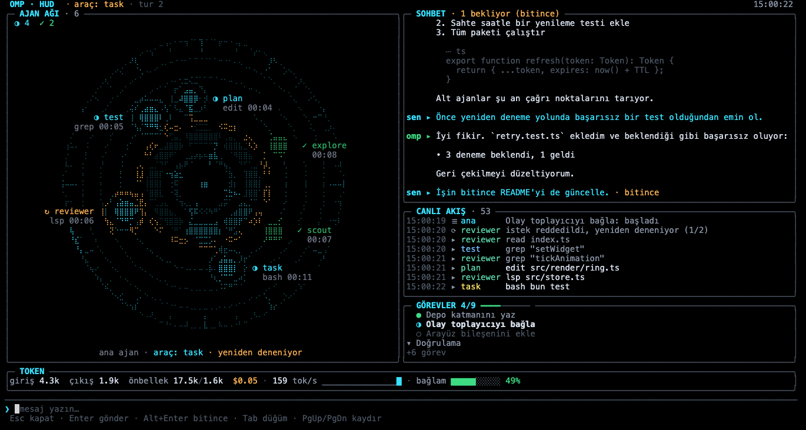
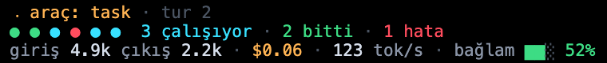
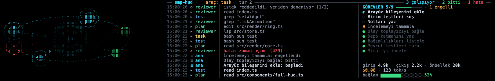

# omp-hud

[English](README.md) | Türkçe

[oh-my-pi](https://github.com/can1357/oh-my-pi) (`omp`) için terminal HUD'u: animasyonlu ajan çekirdeği, alt ajan düğümleri, canlı akış, görevler ve token göstergeleri. Bilimkurgu kokpit ekranlarından esinlenilmiştir. Resmi olmayan bir topluluk eklentisidir; fork gerekmez, mevcut `omp`'ye eklenti olarak girer.



*Görüntü, HTML önizlemesinden (`scripts/preview.ts`) üretildi; braille karakterler gerçek terminalde daha yoğun görünür.*

## Özellikler

- Ortada **animasyonlu ajan çekirdeği**: ana ajan ve anlık durumu (boşta, düşünüyor, yazıyor, araç çalıştırıyor).
- Çekirdeğin çevresinde dönen **alt ajan düğümleri**: çalışan düğüm nabız gibi atar, biten yeşile, hata alan kırmızıya döner.
- Araç çağrıları, alt ajan başlangıç/bitişleri, yeniden denemeler ve bağlam sıkıştırmasından oluşan **canlı akış**.
- İlerlemesiyle birlikte **görevler** (todo listesi).
- **Token göstergeleri**: giriş / çıkış / önbellek tokenları, bağlam penceresi doluluğu (%), saniyedeki token (tok/s) ve maliyet.
- Editörün üstünde **dock** (small 8 / medium 12 / large 16 satır, varsayılan large); oturum başında açıktır: yazarken ve cevap okurken HUD görünür kalır.
- `/hud full` ile **tam ekran** kip (alternatif ekran): canlı paneller ile bir sohbet paneli ve girdi kutusu; ajana yazıp cevaplarını görmek için ekrandan çıkmanız gerekmez. Çıkınca normal ekran bozulmadan geri gelir.
- **Kompakt panel** (`/hud compact on`): editörün altında eski 1-3 satırlık görünüm.
- **`/hud demo`**: sahte olay akışı (yaklaşık 45 sn'lik döngü); tek token harcamadan her şeyi görürsünüz.
- **İngilizce ve Türkçe** arayüz (`en` / `tr`, otomatik algılanır, çalışırken değiştirilebilir).



## Dock



*200 sütunluk demo karesi (`/hud demo`), HTML önizlemeden üretildi; braille gerçek terminalde daha yoğun görünür.*

Dock, editörün hemen üstünde duran bir panel. Böylece HUD görünürken prompt yazmaya ve cevapları okumaya devam edebilirsin. Tam ekran katmanın aksine odağı almaz. Boyutlar: **small 8, medium 12, large 16 satır** (varsayılan large); terminal yüksekliğinin en çok %45'ini alır (en az 4 satır; 20 satırdan kısa terminallerde 4-6 satıra iner).

- **Geniş terminal kullanılır.** 70 sütundan itibaren yörünge sahnesi genişliğin %38'ini (28-72 sütun) alır: çekirdek yuvarlak kalır, yörüngeler alanın tamamını dolduran elipslerdir ve alt ajan düğümleri üzerinde durur (çalışan düğüm atar, biten yeşil, hata veren kırmızı). 96 sütundan itibaren sağ taraf canlı akış ile görev ve token göstergeleri sütununa ayrılır. 70 sütunun altında yörünge yerine kompakt durum bloğu ve akışın son satırları gelir.
- **Boştayken de canlıdır.** Dinlenen çekirdek parlak, nefes alan bir "göz"dür; yörüngelerde birkaç soluk yer tutucu kıvılcım döner (düğüm değildir, gerçek düğüm gelince kaybolur), çekirdeğin altındaki kısa etiket ana ajanın ne yaptığını söyler; sağ blok ana ajanın son olaylarını (yoksa `/hud demo`, `/hud size`, `/hud help` ipucunu), ilk açık görevi ve token toplamlarını gösterir (ilk istekten önce `henüz token yok`). Düşünüyor, yazıyor, araç, hata ve bitti durumlarının her birinin kendi çekirdek animasyonu vardır; dock boyutunda da ayırt edilir.
- **Görevler:** aktif görev önce, sonra bekleyenler gelir; engelli görevler en sona düşer (başlıkta `2 engelli`). Uzun bir engelli listesi sıradaki yapılabilir işi gizlemez.

Dock satırlarını üstündeki konuşma alanından alır; kısa terminallerde `/hud size small` (ya da `OMP_HUD_SIZE=small`) kullan. Boştaki dock saniyede yaklaşık 4, meşgul dock yaklaşık 8 kez yenilenir. Komutlar: `/hud help`.

**Dock neden varsayılan?** Tam ekran HUD ekranın tamamını kaplar. Kendi girdi kutusu ve sohbet paneli vardır ama omp'nin editörü değildir (çok satırlı girdi, ek dosya ve `/hud ...` dışındaki slash komutları yok); 1-3 satırlık kompakt panel ise ekranın altında kolayca kaybolur. Dock çalıştığınız yerde (prompt'un üstünde) görünür kalır, son satırları gizleyen pencerelerde kırpılmaz ve yer gerektiğinde `/hud` ile gizlenir.

omp'siz önizleme: `bun scripts/preview.ts --dock --size large --width 200 --rows 45 --at 3,14,24,36` (demo yerine dinlenen dock için `--idle empty|tasks|used`, HTML dosyası için `--html out.html`).

## Tam ekran

`/hud full` HUD'u alternatif ekranda açar ve odağı alır. Canlı panellerin yanında kendi **sohbet paneli** (sizin mesajlarınız ve ajanın cevapları, canlı akışla; düşünme ve araç çağrıları gösterilmez, onlar akıştadır) ve altta bir **girdi kutusu** vardır.

- **Yerleşim.** 110 sütundan itibaren ajan ağı ekranın **sol yarısını** panel yüksekliğinin tamamında kaplar: büyük bir çekirdek, bölmeyi dolduran dört eliptik halka ve üzerinde alt ajan düğümleri; her düğümün bir etiketi vardır (durum simgesi ve ad; yer varsa altında çalışan araç ve süre). Çalışan düğümler hareket eder, biten yeşil, hata veren kırmızıdır; `Tab` ile seçilen düğüm iki yanında ok ile parlak görünür. Sağ yarıda üstte sohbet (yüksekliğin yaklaşık %55'i), altında canlı akış ve görevler yer alır (yaklaşık 180 sütundan itibaren yan yana, daha darda alt alta). Alt ajan yokken sahne, dock'taki gibi parlak dinlenen çekirdeği ve birkaç soluk yer tutucu kıvılcımı gösterir. 80-109 sütunda yörünge üstte durur (yüksekliğin yaklaşık %45'i); altında sohbet, kısa akış ve görev özeti gelir. Daha dar ya da kısa terminallerde aynı sıra 8 satırlık yörüngeyle sürer (sohbet hep 6 satır korur; yaklaşık 19 satırın altında yörünge çekilir). Token şeridi ve girdi kutusu (çizgi, girdi satırı, tuş ipucu) hep en alttadır. Düğüm ayrıntısı (`Tab`, sonra boş `Enter`) bölme yeterince yüksekse yörüngenin altında açılır, değilse yörüngenin yerine geçer; sohbet hiç örtülmez.
- **Gönderme.** `Enter` metni omp'ye kullanıcı mesajı olarak gönderir. Ajan meşgulken mesaj kuyrukta bekler (`· sırada` etiketi) ve mevcut turdan sonra çalışır; `Alt+Enter` ise çalışan turu yönlendirir (`· yönlendirildi`). Gönderdiğiniz mesaj hemen görünür ve omp'nin kendi kullanıcı mesajıyla eşleştirilir; yani iki kez görünmez. Sohbet ayrıca editörden yazılan mesajları, oturum başında ya da oturum değişince de oturum geçmişinin son 40 mesajını gösterir.
- **Komutlar.** HUD içinde yalnız `/hud ...` satırları çalışır (örneğin `/hud help`, `/hud lang tr`); çıktıları sohbet panelinde `hud ▸` etiketiyle görünür. Diğer her `/` satırı bir ipucuyla reddedilir (omp, eklentinin gönderdiği metinde komut açmaz) ve metin girdi kutusunda kalır.
- **Kaydırma.** Panel en yeni satırı izler. `PgUp` / `Ctrl+↑` izlemeyi bırakır (başlıkta `↓ yeni` görünür); yeni metin okuduğunuz yeri kaydırmaz. `End` / `Ctrl+End` yeniden izler.
- **Metin işleme.** Mesajlardan kontrol karakterleri ve ANSI dizileri temizlenir; çok uzun mesajlar kısaltılır (mesaj başına 12 KB, en çok 40 mesaj). Markdown sade metin olarak gösterilir: başlık ve kalın işaretleri düşer, listeler işaretini korur, kod blokları sönük ve girintilidir. **Hiçbir satır kesilmez:** geniş satırlar panel genişliğinde (görünen hücre genişliğine göre) sözcük sınırında sarılır; panelden geniş bir sözcük (URL, yol) ve kod satırı hücre hücre bölünür (kod devam satırları `↪` ile başlar). Panele sığmayan bir markdown tablosu kayıtlara dönüşür: her satır için ilk hücre, altında `başlık: değer` satırları; sığan tablo yazıldığı gibi kalır. Genişlik değişince (pencere boyutu) kaydırdığınız yer aynı mesajda kalır.

Model olmadan denemek için: `/hud demo full` (orada yazdıklarınız omp'ye gitmez). omp'siz önizleme: `bun scripts/preview.ts --at 14,22 --width 200 --height 50 --html out.html` (başka boyutlar için örneğin `--width 100 --height 30`).

## Kurulum

Eklenti desteği olan `omp` (oh-my-pi) gerekir. Yalnızca **omp 18.8.9** üzerinde geliştirildi ve denendi ([Uyumluluk](#uyumluluk-ve-dürüst-sınırlar) bölümüne bakın). Derleme adımı ve bağımlılık yoktur: omp TypeScript'i doğrudan çalıştırır.

### GitHub'dan (ana yöntem)

```sh
omp plugin install github:suleymanozcan/omp-hud
```

`omp install github:suleymanozcan/omp-hud` aynı işi görür; `git+https://github.com/suleymanozcan/omp-hud.git` da geçerli bir belirteçtir (omp'nin git belirteç biçimi: `github:kullanıcı/depo[#ref]`, `git+https://...`, `git@github.com:kullanıcı/depo`). Ardından `omp`'yi yeniden başlatın: eklentiler yalnızca başlangıçta yüklenir. Güncellemek için `omp plugin upgrade omp-hud`, kaldırmak için `omp plugin uninstall omp-hud`.

> omp 18.8.9 ile yalıtılmış bir profilde doğrulandı: `omp plugin install github:suleymanozcan/omp-hud` `omp-hud@0.1.0` sürümünü kurar; `omp plugin list` ve `omp plugin doctor` sağlıklı olduğunu bildirir; yeniden başlatmadan sonra `/hud help` ve `/hud lang en` çalışır. `omp install github:suleymanozcan/omp-hud`, `git+https://github.com/suleymanozcan/omp-hud.git` ve `omp plugin upgrade omp-hud` aynı biçimde çalıştırıldı ve başarılı oldu (`git@github.com:` biçimi denenmedi).

### Yerel kopyadan (denendi)

```sh
git clone https://github.com/suleymanozcan/omp-hud.git
omp plugin link ./omp-hud
```

`omp plugin link`, kopyayı omp'nin eklenti dizinine sembolik bağlantı olarak ekler (`omp install ./omp-hud` aynı işi yapar). Güncellemek için kopyada `git pull` yeterlidir. Ardından `omp`'yi yeniden başlatın.

### Eklentiler dizinine sembolik bağlantı (denendi)

```sh
mkdir -p ~/.omp/agent/extensions
ln -s "$PWD/omp-hud" ~/.omp/agent/extensions/hud
```

omp `~/.omp/agent/extensions/<ad>/` altını tarar ve `package.json#omp.extensions` alanını okur.

> `~/.omp/agent/extensions/hud/index.ts` içine `export { default } from "/yol/omp-hud/index.ts"` yazan bir yönlendirme dosyası **çalışmaz**: omp `@oh-my-pi/pi-tui` paketini yönlendirme dosyasından çözemez. Klasörün tamamına sembolik bağlantı kullanın.

### Kurmadan denemek (denendi)

```sh
omp -e ./omp-hud
```

### Yapılandırma dosyası (denendi)

`~/.omp/agent/config.yml` içinde (kopyanızın tam yolunu yazın):

```yaml
extensions:
  - /kopyanin/tam/yolu/omp-hud
```

## Kullanım

| Komut | Etki |
| --- | --- |
| `/hud` | Dock'u açar/kapatır (varsayılan görünüm; oturum başında açık): editörün yanında 8 / 12 / 16 satırlık panel, odağı almaz, yazmaya devam edersiniz. |
| `/hud full` | Sohbet paneli ve girdi kutusu olan tam ekran HUD (son satırı `/hud pad` boş bırakır). |
| `/hud size small\|medium\|large` | Dock boyutu: 8 / 12 / 16 satır (varsayılan large, ortam `OMP_HUD_SIZE`); argümansız boyutu ve bu terminal yüksekliğinde aldığı satırı gösterir. |
| `/hud place above\|below` | Dock editörün üstünde (varsayılan) ya da altında (ortam `OMP_HUD_PLACE`); açıksa yeniden kurulur. |
| `/hud demo` | Dock'ta sahte olay akışı (gerekirse demo için dock'u açar; yeniden ya da `/hud demo off` durdurur). Gerçek oturum durumuna dokunmaz. |
| `/hud demo full` | Aynı sahte akış tam ekran HUD'da. |
| `/hud compact on\|off` | Editörün altındaki eski 1-3 satırlık panel (argümansız: tersine çevirir). Açmak dock'u kapatır, tersi de geçerli: ikisi aynı veriyi iki kez gösterirdi. |
| `/hud lang tr\|en\|auto` | Arayüz dilini bu çalışma için değiştirir (kalıcı değildir); argümansız mevcut dili gösterir. |
| `/hud status on\|off` | omp'nin durum metninde tek satırlık özet (`hud ○ hazır`, `hud ⠹ düşünüyor · 2 çalışıyor 1 bitti · giriş 12k çıkış 3k · bağlam 42%`); varsayılan açık; argümansız durumu gösterir. |
| `/hud pad 0-3` | Editörün altındaki görünümler ve tam ekran HUD için alt tarafta boş bırakılan satır (varsayılan 1, ortam `OMP_HUD_PAD`); argümansız değeri gösterir. Editörün üstündeki dock'a uygulanmaz. |
| `/hud doctor` | Tanı: sürüm, dil, mod, dock / kompakt / durum satırı durumu, terminal boyutu, mağaza, zamanlayıcı. Ortam dökümü yok (yalnız `OMP_HUD_LANG` ve `COLORTERM`). |
| `/hud help` | Komut özetini gösterir. |

Her komut kısa bir bildirimle yanıt verir (örneğin `Kompakt HUD: açık (editörün altında 1-3 satır)` ya da `zaten açık`).

Tam ekrandaki tuşlar ([Tam ekran](#tam-ekran) bölümünde ayrıntı):

| Tuş | Etki |
| --- | --- |
| yazı, `Backspace`, `Delete`, `←` / `→`, `Home` / `End`, `Ctrl+A` / `Ctrl+E`, `Ctrl+U` (temizle), `Ctrl+W` (kelime sil), `Ctrl+K` (sona kadar sil), yapıştırma | Girdi kutusunu düzenler. |
| `↑` / `↓` | Bu oturumun girdi geçmişi (50 kayıt). |
| `Enter` | Girdiyi gönderir. Girdi boşken ve bir düğüm seçiliyse düğüm ayrıntısını açar/kapatır. |
| `Alt+Enter` | Çalışan tura yönlendirme olarak gönderir (ajan meşgulken varsayılan: turun arkasında sıraya girer). |
| `Tab` / `Shift+Tab` | Sonraki / önceki düğümü seçer. |
| `PgUp` / `PgDn`, `Ctrl+↑` / `Ctrl+↓` | Sohbeti kaydırır. |
| `End` (girdi boşken), `Ctrl+End` | En yeni satıra atlar ve yeniden izler. |
| `Esc` | Ayrıntı açıksa onu kapatır; değilse dolu girdiyi temizler; değilse HUD'dan çıkar. |

### Dil

Arayüz `OMP_HUD_LANG=en|tr` değerini izler; tanımsızsa `LC_ALL`, `LC_MESSAGES`, `LANG` değişkenlerinden ilk tanımlı olan belirler (`tr…` Türkçe verir), yoksa İngilizce.

```sh
OMP_HUD_LANG=tr omp
```

## omp'siz önizleme

Yalnızca [Bun](https://bun.sh) gerekir. Hiçbiri omp'yi başlatmaz ya da model çağırmaz; demo sanal zamanla ilerler.

```sh
# terminalde canlı izle (alternatif ekran, ~15 fps; Esc / Ctrl-C çıkar)
bun scripts/preview.ts --live

# kareleri 24-bit ANSI metni olarak bas
bun scripts/preview.ts --frames 3 --width 140 --height 40 --at 3,14,24

# HTML sayfası yaz (kompakt widget için --compact ekleyin)
bun scripts/preview.ts --frames 2 --width 140 --height 40 --at 14,24 --compact --html /tmp/hud.html
```

`bun scripts/preview.ts --help` tüm seçenekleri listeler. Komutlar her klasörden çalışır.

## Uyumluluk ve dürüst sınırlar

- **Yalnızca omp 18.8.9'da denendi** (macOS; Ghostty ve cmux). Diğer omp sürümleri ve diğer terminaller: bilinmiyor.
- **Belgelenmemiş iç kanallara dayanır.** Alt ajan verisi `pi.events` üzerindeki `task:subagent:lifecycle` ve `task:subagent:progress` olaylarından, tam ekran ise overlay `fullscreen` seçeneğinden gelir. İkisi de belgeli sözleşme değildir; omp güncellenince bozulabilir. Yedek yollar vardır: alt ajan olayları değişirse alt ajan düğümleri boş kalabilir, çekirdek, akış, görevler ve token göstergeleri çalışmaya devam eder; `fullscreen` kalkarsa HUD normal bir overlay'e düşer.
- **omp'nin ana görünümünü değiştirmez.** omp'de `setHeader` / `setFooter` etkisizdir; HUD yalnızca widget'lar (editörün yanındaki dock, altındaki kompakt panel), durum metni satırı ve tam ekran overlay olarak görünür.
- **Tam ekranın kendi girdi kutusu vardır, omp'nin editörü değildir.** `/hud full` bir sohbet paneli ve tek satırlık bir girdi kutusu gösterir; omp'nin editörünü değil: çok satırlı girdi, ek dosya ya da `@` otomatik tamamlama yoktur ve yalnız `/hud ...` komutları çalışır (diğer `/` komutları bir ipucuyla reddedilir; `Esc` ile çıkıp editörü kullanın). Gönderdiğiniz metin ajana düz kullanıcı mesajı olarak gider (şablon açılımı yok). Dock odağı almaz: orada normal editörü kullanmaya devam edersiniz.
- **Terminal:** braille ve blok karakterler yoğun kullanılır; braille'i iyi çizen bir yazı tipiyle truecolor terminal (`COLORTERM=truecolor`) önerilir. Terminal en az 50x14 olmalıdır. TUI olmayan kiplerde HUD kurulmaz.
- **Yerleşik özelliklerle örtüşme:** omp'nin Agent Hub'ı (`Alt+A`) benzer alt ajan verisini gösterir. Editörün üstündeki yerleşik "Subagents" bloğu HUD ile çakışırsa `display.pinnedAgents: off` ayarlayın.

## Sorun giderme

- Hiçbir şey görünmüyorsa: `omp`'yi yeniden başlatın (eklentiler yalnızca başlangıçta yüklenir) ve `/hud help` yazın. Komut bilinmiyorsa eklenti yüklenmemiştir.
- omp günlüklerinde (`~/.omp/logs/`; adlandırılmış profil `~/.omp/profiles/<ad>/logs/` altına yazar) `Failed to load extension` arayın. Tipik nedenler: yanlış ya da taşınmış yol, sembolik bağlantı yerine yönlendirme dosyası (yukarıya bakın).
- Renkler soluksa: terminalde `COLORTERM=truecolor` olmalıdır.
- Yeniden boyutlandırmadan sonra tam ekran bozulursa: bir kez daha boyutlandırıp `/hud full` komutunu yeniden verin.
- HUD görünmüyorsa: `/hud doctor` yazın. `dock:` satırı açık/kapalı durumunu, boyutu ve alması gereken satır sayısını, son `setWidget` çağrısının sonucunu, `bağlandı: evet` (omp widget'ı oluşturdu) bilgisini ve son çizilen boyutu (`çizim N (son GxS)`) gösterir. `/hud` komutunu da deneyin (bildirimle yanıtlar: `HUD dock: açık (large, editörün üstünde)` ya da `kapalı`) ve terminalin en az yaklaşık 20 satır olduğundan emin olun (daha kısa terminallerde dock 4-6 satıra iner).
- Terminal penceresi alt satırları kırpıyorsa (bazı pencereler son bir iki satırı gizler): dock editörün üstünde durduğu için etkilenmez. Editörün altındaki görünümler etkilenir: `/hud place below`, `/hud compact on` ve tam ekran HUD. Bunlar için `/hud pad 2` (ya da `OMP_HUD_PAD=2`; 0-3, varsayılan 1) panelin altında o kadar boş satır bırakır ve tam ekran HUD'u o kadar satır kısaltır; böylece alt ipucu satırı görünür kalır. Dock editörün üstündeyken boşluk uygulanmaz.
- Alt kısımda hâlâ bir şey yoksa: HUD omp'nin durum metnine de tek satırlık özet yazar (`hud ○ hazır`, anahtar `hud`; omp 18.8.9'da editörün altında tek satır olarak doğrulandı). Bu, widget'lara bağlı değildir. `/hud status on` ile açın. Görünmüyorsa omp'nin `statusLine.showHookStatus` ayarının `false` olmadığına bakın.

## Geliştirme

```sh
bunx -p typescript tsc --noEmit -p .   # tip denetimi (düz `bunx tsc` yanlış paketi çözer)
bun scripts/smoke-collector.ts         # toplayıcı / mağaza duman testi
bun scripts/preview.ts --live          # gözle bakmak için
```

Henüz test paketi yoktur.

```
index.ts                 eklenti girişi: komutlar, zamanlayıcı
src/types.ts             veri sözleşmesi (HudState, HudStore, HudTheme)
src/store.ts             mağaza
src/collector.ts         omp olaylarını mağazaya yazar
src/demo.ts              /hud demo için sahte olay akışı
src/i18n.ts              en / tr metinleri
src/status-text.ts       durum çubuğu için tek satırlık düz metin özeti
src/pad.ts               alt boşluk (`/hud pad`, `OMP_HUD_PAD`)
src/layout-settings.ts   dock boyutu ve yeri (`/hud size`, `/hud place`, `OMP_HUD_SIZE`, `OMP_HUD_PLACE`)
src/dock-i18n.ts         yalnız dock'a ait en / tr metinleri
src/render/              braille tuval, çekirdek, yörünge halkaları, dock sahnesi, tam ekran sahnesi (düğüm etiketleri), akış, görev, token, yerleşim
src/components/          DockHud (editörün yanındaki widget), FullHud (overlay), CompactHud (1-3 satır), PaddedComponent
scripts/preview.ts       omp'siz önizleme (kareler / HTML / canlı)
scripts/ansi-to-html.ts  önizleme için ANSI -> HTML dönüştürücü
scripts/shim-pi-tui.ts   düz bun için pi-tui taklidi (yalnız önizleme ve duman testi)
```

## Lisans

[MIT](LICENSE)
